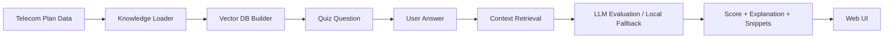
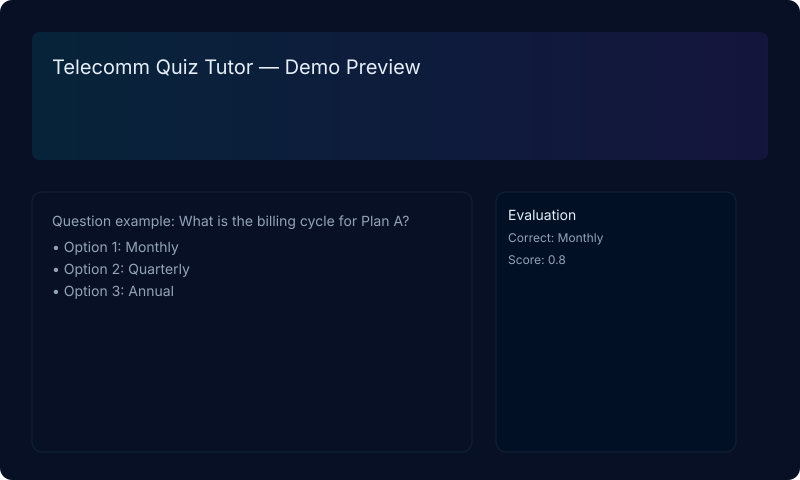

# Telecomm Quiz Tutor Bot

A smart AI-powered telecom learning assistant designed to turn telecom plan knowledge into interactive quiz-based learning experiences, evaluate learner responses, and explain concepts with evidence-backed feedback.

<p align="center">
  
  
  
  
</p>

## Overview

Telecomm Quiz Tutor Bot is a lightweight AI learning project focused on telecom product education. It helps users understand telecom plans, services, and trade-offs by combining:

- telecom knowledge stored in structured data
- semantic retrieval from the plan corpus
- AI-powered answer evaluation
- explanation-driven feedback for learning

This project is useful for:

- telecom training and onboarding
- self-learning and concept review
- AI demo showcases
- portfolio and interview presentations

## Why this project matters

Telecom learning often involves understanding product details, service differences, and customer-specific requirements. This project simplifies the process by creating a guided loop:

1. present a telecom question
2. retrieve relevant context from the knowledge base
3. evaluate the learner response
4. provide feedback and relevant evidence
5. reinforce understanding through explanation

## Key Features

- Telecom-specific quiz generation
- Answer evaluation with AI-assisted feedback
- Relevant context retrieval from telecom knowledge
- Local fallback evaluation when OpenAI is unavailable
- Minimal, clean Flask-based UI
- Easy local setup and fast demo execution

## System Architecture



## Data Flow

```text
1. Load telecom plan details from the JSON data source
2. Build the in-memory document embeddings
3. Select a quiz question for the learner
4. Capture the user response
5. Retrieve the most relevant telecom context
6. Evaluate the answer with AI or fallback logic
7. Display score, explanation, and supporting snippets
```

## Project Structure

```text
Telecomm-Quiz-Tutor-Bot/
├── LICENSE
├── README.md
├── letstry/
│   ├── app.py
│   ├── llm_client.py
│   ├── quiz_engine.py
│   ├── vector_db.py
│   ├── requirements.txt
│   ├── data/
│   │   └── plan_details.json
│   ├── static/
│   │   ├── demo-screenshot.svg
│   │   ├── logo.svg
│   │   └── styles.css
│   └── templates/
│       └── index.html
├── scripts/
│   └── make_demo_gif.sh
├── TELECOMM quiz_GenAI_HLD.docx
├── telecomm_tutor_bot_G-AI_LLD.pdf
├── Telecomm Quiz  Report(2)(1).pdf
└── additional design and research documents
```

## Tech Stack

- Python 3.10+
- Flask
- NumPy
- OpenAI API
- python-dotenv
- HTML / CSS / JavaScript

## Demo Preview



## Getting Started

Follow the steps below to run the project on your local machine.

### 1. Clone the repository

```bash
git clone https://github.com/mohddilshadkhan2003/Telecomm-Quiz-Tutor-Bot.git
cd Telecomm-Quiz-Tutor-Bot
```

### 2. Create a virtual environment

#### macOS / Linux

```bash
python3 -m venv .venv
source .venv/bin/activate
```

#### Windows (PowerShell)

```powershell
python -m venv .venv
.venv\Scripts\Activate.ps1
```

### 3. Install dependencies

```bash
cd letstry
pip install -r requirements.txt
```

### 4. Set up environment variables

The application can run without an API key using its local fallback evaluator, but you can enable OpenAI-based evaluation as well.

#### macOS / Linux

```bash
export OPENAI_API_KEY="your_openai_api_key_here"
```

#### Windows (PowerShell)

```powershell
$env:OPENAI_API_KEY = "your_openai_api_key_here"
```

### 5. Run the app

```bash
python app.py
```

### 6. Open in your browser

```text
http://127.0.0.1:5000
```

## How to Use

- open the app in the browser
- choose a telecom quiz question
- type or select your answer
- view the evaluation result, score, and supporting context
- review the explanation and snippets to improve understanding

## Future Enhancements

- user authentication and dashboards
- database-backed quiz history and progress tracking
- analytics for learner performance
- production-grade vector search integration
- CI/CD setup and automated tests
- more telecom modules and training scenarios

## Maintainer

Built and maintained by: Dilshad Khan

## Project Status

This project is a strong AI-learning prototype with a practical telecom use case, clean frontend interaction, and a useful retrieval + evaluation flow. It is well-suited for demonstration, learning, and portfolio presentation.

---

This repository demonstrates how a simple AI-assisted app can combine telecom knowledge, product understanding, and interactive learning into a practical and user-friendly experience.
