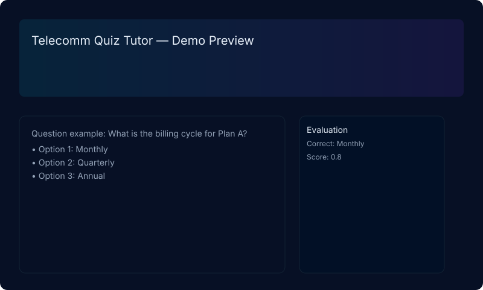

# Telecomm Quiz Tutor Bot

A smart AI-powered telecommunication learning assistant that turns telecom plan details into interactive quiz experiences, evaluates learner responses, and delivers targeted explanations to improve understanding.

  
  
  
  

## Elevator pitch (for recruiters)

Built a lightweight, production-capable prototype of an AI-driven tutor that:

- Converts telecom plan documentation into a contextual knowledge base
- Generates targeted assessment questions and evaluates free-text answers
- Uses vector retrieval + LLMs for context-aware explanations and feedback

Why this matters: demonstrates system design, LLM integration, and user-facing product thinking — all valuable for engineering and product roles.

## Screenshot / demo

(Or run locally: `cd letstry && python app.py` and open http://127.0.0.1:5000)

## Features (reformatted for portfolios)

- Contextual knowledge graph from telecom plan data
- LLM-driven answer evaluation with human-readable explanations
- Fast vector retrieval for contextual evidence snippets
- Clean browser UI for live assessment and feedback
- Fallback local evaluator so the app remains usable offline

## Architecture (technical summary)

- Frontend: Minimal Flask + HTML/CSS (single-page interaction)
- Backend: Flask app that loads knowledge, builds in-memory vector store, and exposes evaluation endpoints
- LLM integration: `letstry/llm_client.py` — wraps OpenAI API calls and fallback behavior
- Retrieval: `letstry/quiz_engine.py` + `letstry/vector_db.py` — build and query vectorized context

This architecture highlights separation of concerns and a research-to-production flow: data -> vectorization -> retrieval -> LLM evaluation -> UI.

## How to present this in an interview

- Walk through the architecture diagram above and explain trade-offs (in-memory vector store vs. persistence, local fallback for reliability, LLM costs).
- Show the demo and point to the evaluation flow (question -> retrieve context -> LLM evaluate -> feedback + snippets).
- Discuss future scaling steps (persist vector DB, add CI/CD, add authentication & analytics).

## Maintainer

Maintained by `@mohddilshadkhan2003` — feel free to open issues or PRs.
